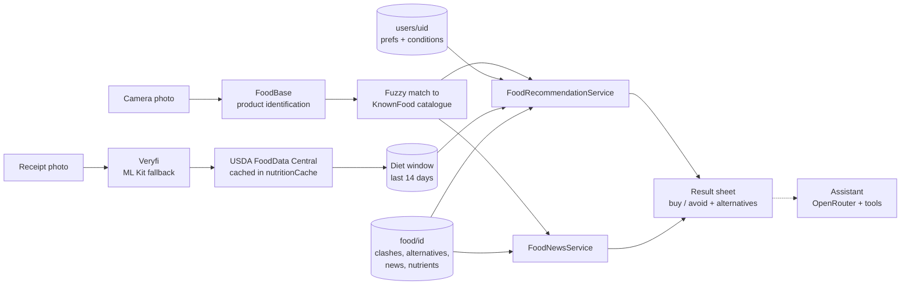

# whack2026

A Flutter shopping and nutrition assistant built for WHACK 2026. Point the
camera at a product in a shop and the app identifies it, checks it against
your religion, dietary requirements, health conditions and recent diet, and
says whether it suits you or what to buy instead, along with any food-safety
news about it. Scanned grocery receipts build a two-week diet history that
shows which vitamins and minerals you are short of. A voice-capable
assistant can answer questions about all of this. It is for shoppers who
need to check food against beliefs, allergies, intolerances or a medical
condition and don't want to read every label.

## Features

- **Product scanning.** A full-screen camera sends a photo of the package
  to the FoodBase product-photo API. The returned name is fuzzy-matched
  against the stored food catalogue, so a name like "Tesco Granny Smith
  Apples 6 Pack" finds "Apple". The default is capture-on-tap. An
  auto-capture mode (`ScanMode.stream` in `lib/scan/scan_config.dart`) sends
  a frame on its own once the item has been held steady.
- **Buy or avoid recommendations.** Each food is checked against the user's
  saved beliefs, dietary requirements and health conditions, and against
  the nutrients they are short of or over on in their recent diet. If a
  food clashes, the app shows stored alternatives for that
  condition/preference pair. Users can turn off swap suggestions for a
  particular item.
- **Food news alerts.** The scan result shows local news, such as recalls,
  and general information stored for the food. If there is none, a green
  "no news" card appears.
- **Receipt scanning and diet history.** A photographed receipt is read by
  the Veryfi API, with on-device ML Kit OCR and a local parser as fallback.
  The user reviews the items and stores them by purchase day. The History
  tab lists stored days with their aggregated nutrients. Only the last two
  weeks are kept.
- **Nutrient tracker.** Vitamins and minerals come from USDA FoodData
  Central and are cached in Firestore. Average daily intake is compared
  with UK adult reference values (sodium is treated as a limit). The
  tracker opens from the History tab.
- **Nutrient garden.** The home screen is a full-screen animated river
  valley, with a day/night cycle and a new season every day, that
  grows lusher as your recent diet meets the same vitamin and mineral targets as the
  tracker, and shrink when you go over the sodium limit. With no diet data
  yet, a hint suggests scanning a receipt.
- **Shopping assistant.** A chat tab that runs on OpenRouter with tool
  calling. It can read the user's profile, health readings, diet and food
  history, the food catalogue, alternatives, news and food images. It
  proposes preference changes and manual food logs, and nothing is saved
  until the user confirms. Speech-to-text input and text-to-speech replies
  are available. The name, tone, answer length, humour and voice can be
  customised. Start **Shopping companion** over the camera for steady-product
  auto-capture, spoken summaries, alternative image cards and voice/text
  questions without leaving the preview. The app-bar chat button opens the
  same full conversation. Listening uses explicit microphone turns and stops
  when the session leaves the foreground.
- **Health data (Android).** After the user opts in, the app reads heart
  rate, steps, sleep, weight and blood pressure through a native Health
  Connect channel. Blood-pressure records are synced every minute while
  the app is in the foreground. Height and weight are entered by hand, and
  BMI is calculated from them.
- **Appearance.** Light, dark or automatic mode and a choice of accent
  colours. Tinted Material 3 schemes are generated from the accent and
  stored on the device.
- **Accounts.** The user is signed in anonymously with Firebase Auth when
  the app starts, so there is no sign-in screen.

## How it works



- **Food catalogue.** The shared `food` collection is filled offline by
  `tool/fill_food_db.dart`, which uses OpenRouter with web search for each
  food's clashes, alternatives, news and nutrients. The same pipeline
  regenerates `lib/food/known_foods.g.dart`, the typed `KnownFood` enum used
  for matching. Food images come from Wikipedia and are stored in
  `food_images`.
- **External services.**

  | Service | Used for | Code |
  | --- | --- | --- |
  | Firebase Auth / Cloud Firestore | Anonymous accounts and all stored data | `lib/main.dart`, throughout |
  | FoodBase | Product identification from a photo | `lib/foodbase/`, `lib/scan/product_identification_service.dart` |
  | OpenRouter (`@preset/glm-flash`) | Assistant, catalogue generation tools | `lib/openrouter/` |
  | Veryfi | Receipt OCR and line-item extraction | `lib/diet/veryfi_service.dart` |
  | Google ML Kit text recognition | On-device receipt OCR fallback | `lib/diet/receipt_scan_page.dart` |
  | USDA FoodData Central | Vitamins and minerals per food | `lib/diet/nutrition_service.dart` |
  | Android Health Connect | Heart rate, steps, sleep, weight, blood pressure | `android/.../MainActivity.kt`, `lib/health_data/` |
  | Tesco (store locator, `xapi.tesco.com`) | Offline product/store dumps only; not used by the app at runtime | `lib/tesco/`, `tool/tesco_food_dump.dart`, `tool/fetch_tesco_stores.py` |

## Tech stack

Flutter (Dart SDK `^3.13.7`, Material 3) · Firebase Auth and Cloud Firestore ·
`camera` · `google_mlkit_text_recognition` · `speech_to_text` and
`flutter_tts` · `shared_preferences` · `http` and `crypto` (for
Veryfi request signing) · Kotlin Health Connect bridge on Android ·
Python for the Firestore rules test and the Tesco store snapshot.

## Getting started

### Prerequisites

- Flutter SDK (stable) whose Dart version satisfies `^3.13.7`.
- An Android device or emulator with API level 28 or higher (`minSdk` is at
  least 28). Health Connect is needed for the health features. The camera,
  speech and ML Kit features are meant for a physical device.
- API keys for OpenRouter, Veryfi, FoodBase and USDA FoodData Central.

### Setup

```sh
git clone https://github.com/nmarteybotchway/whack2026.git
cd whack2026
cp lib/secrets.example.dart lib/secrets.dart   # git-ignored; fill in keys
flutter pub get
flutter run                                    # pick the Android device
```

`lib/secrets.dart` must exist before anything will compile. It defines:

| Constant | Where to get it | Without it |
| --- | --- | --- |
| `openRouterApiKey` | https://openrouter.ai/keys | Assistant and catalogue tools fail |
| `foodBaseApiKey` | FoodBase dashboard | Scans return "FoodBase API key is not configured" |
| `veryfiClientId`, `veryfiUsername`, `veryfiApiKey` | https://app.veryfi.com (Settings → API Keys) | Receipts fall back to ML Kit |
| `usdaApiKey` | https://fdc.nal.usda.gov/api-key-signup | Nutrient lookups fail |

### Firebase

The app is already configured for the Firebase project `whack-2026-c7898`
through `lib/firebase_options.dart` and `firebase.json`. To use your own
project, run `flutterfire configure`, enable **Anonymous** sign-in, and
deploy the rules:

```sh
firebase deploy --only firestore:rules --project <your-project-id>
```

### Release build

```sh
flutter build apk --release
```

The release build is signed with the debug key (`android/app/build.gradle.kts`),
which is fine for sideloading but not for publishing to the Play Store.

## Testing

```sh
flutter test      # unit and widget tests under test/
flutter analyze   # lints (flutter_lints)
```

The Firestore security rules have a Python test that only runs against the
local emulator:

```sh
firebase emulators:exec --only firestore --project demo-assistant \
  --config firebase.assistant-test.json \
  'python3 test/firestore/assistant_rules_test.py'
```

## Food catalogue tooling

These are plain Dart scripts that talk to Firestore over REST. They sign in
anonymously and read the OpenRouter key from `lib/secrets.dart`. Each one
accepts `--dry-run`.

| Command | Purpose |
| --- | --- |
| `dart run tool/fill_food_db.dart food.txt` | Run the whole pipeline (the four steps below) |
| `dart run tool/fill_food.dart food.txt [--full]` | Add foods from `food.txt` and refresh news |
| `dart run tool/dedupe_food.dart` | Merge foods stored under different names |
| `dart run tool/fill_food_images.dart [--retry]` | Find a Wikipedia image for each food and alternative |
| `dart run tool/generate_food.dart` | Regenerate `lib/food/known_foods.g.dart` |
| `dart run tool/inspect_food_images.dart [limit]` | Read-only inspection of `food_images` |
| `dart run tool/tesco_food_dump.dart "CV4 7AL" [out.json] [--details] [--large]` | Dump a nearby Tesco store's food range to JSON |
| `python3 tool/fetch_tesco_stores.py` | Snapshot Tesco's UK store list into `assets/tesco_stores.json` |

## Project structure

| Path | Contents |
| --- | --- |
| `lib/main.dart` | Firebase init, anonymous sign-in `AuthGate`, theming |
| `lib/pages/` | Home shell (Home, History, Scan button, Assistant, Settings) and the Settings page |
| `lib/scan/` | Camera page, frame gate for auto-capture, FoodBase identification, result sheet |
| `lib/food/` | `Food` model, catalogue repository, fuzzy matcher, recommender, preferences, conditions, nutrients, generated `known_foods.g.dart` |
| `lib/food_news/` | Food news lookup from the `food` collection |
| `lib/foodbase/` | FoodBase product-photo API client |
| `lib/diet/` | Receipt scanning (Veryfi and ML Kit), diet store, 14-day window, USDA nutrition, tracker and history pages |
| `lib/garden/` | Nutrient garden (painted sunrise valley) and nutrient score service |
| `lib/assistant/` | Assistant controller, models, Firestore tool repository, chat and settings pages |
| `lib/services/` | Speech-to-text and text-to-speech wrappers |
| `lib/openrouter/` | OpenRouter chat-completions client (structured JSON, images) |
| `lib/health_data/` | Health Connect sources and sync, health summary, body measurements, heart rate and blood pressure pages |
| `lib/appearance/`, `lib/theme.dart` | Light/dark mode, accent picker, Material 3 theme |
| `lib/tesco/` | Tesco store directory and product API client (used by tools) |
| `lib/ai/` | Earlier OpenRouter-based food compliance check and demo; not wired into the app |
| `tool/` | Food catalogue pipeline and Tesco data scripts |
| `test/` | Dart unit and widget tests, plus `test/firestore/` emulator rules test |
| `assets/` | `tesco_stores.json`, TTS model files |

## Firestore data layout

All data belonging to a user is stored under `users/{uid}/`, where `{uid}`
is the signed-in user's Firebase Auth UID
(`FirebaseAuth.instance.currentUser!.uid`). Nothing user-specific is written
outside this path, so the security rules can limit each user to their own
subtree.

```
users/{uid}                       religion, dietary, health_conditions, ...
  healthProfile/measurements      height, weight, BMI, units
  healthData/latest               heart rate, steps, sleep, weight, BP, optedIn
  bloodPressure/{recordId}        Health Connect blood-pressure readings
  diet/{yyyy-MM-dd}               foods bought that day + aggregated nutrition
  receipts/{receiptId}            in rules and read by the assistant; nothing writes it yet
  foodEntries/{entryId}           manual eaten/purchased logs from the assistant
  assistantSettings/preferences   assistant personality and voice
  assistantActions/{actionId}     immutable record of confirmed assistant writes

food/{foodId}                     shared catalogue: clashes, alternatives, news, nutrients
food_images/{imageId}             Wikipedia image URL and page per food name
nutritionCache/{foodName}         shared USDA nutrient lookups
```

Shared collections can be read by any signed-in user. The rules are in
`firestore.rules`.

## Documentation

- [Architecture](docs/architecture.md)
- [Setup](docs/setup.md)
- [Recommendations](docs/recommendations.md)
- [Food data](docs/food-data.md)
- [Scanning](docs/scanning.md)
- [Diet and nutrients](docs/diet-and-nutrients.md)
- [Health data](docs/health-data.md)
- [Shopping assistant](docs/assistant.md)
- [Voice assistant plan](docs/voice-assistant-plan.md)
- [Health data module notes](lib/health_data/README.md)
