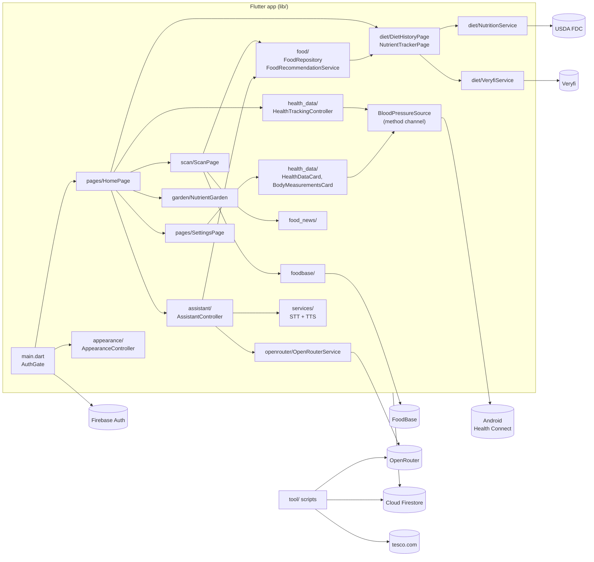

# Architecture

This page gives an overview of the whole Flutter app (package name `hackathon`): how it
starts, how screens connect, what each `lib/` directory does, which outside
services it calls, and how its data is laid out in Firestore. Each feature
has its own page that goes deeper:

| Topic | Doc |
| --- | --- |
| Developer setup, keys, running, deploying | [setup.md](setup.md) |
| Health Connect, blood pressure, height/weight | [health-data.md](health-data.md) |
| Product scanning | [scanning.md](scanning.md) |
| Diet history, receipts, nutrients | [diet-and-nutrients.md](diet-and-nutrients.md) |
| Food recommendations / alternatives | [recommendations.md](recommendations.md) |
| Shared `food` database and `tool/` pipeline | [food-data.md](food-data.md) |
| Voice/chat assistant | [assistant.md](assistant.md) |

## Entry point and wiring

`lib/main.dart`:

1. `main()` calls `WidgetsFlutterBinding.ensureInitialized()`, then
   `Firebase.initializeApp(options: DefaultFirebaseOptions.currentPlatform)`.
   The options come from `lib/firebase_options.dart`, which FlutterFire
   generated for project `whack-2026-c7898`.
2. `AppearanceController.load()` (`lib/appearance/appearance_controller.dart`)
   reads the saved theme mode and accent from `shared_preferences` (keys
   `appearance.mode` and `appearance.accent`). It falls back to
   `ThemeMode.system` and `ThemeAccent.freshGreen` when nothing is saved or
   storage is unavailable.
3. `MyApp` wraps everything in `AppearanceScope`, an `InheritedNotifier`, and
   uses a `ListenableBuilder` to rebuild `MaterialApp` with
   `AppTheme.light(accent)`, `AppTheme.dark(accent)` and `themeMode` from the
   controller. Any change on `AppearancePage` re-themes the app straight away.
4. `home: AuthGate`. There is **no sign-in UI**. `AuthGate` listens to
   `FirebaseAuth.instance.authStateChanges()` and calls `signInAnonymously()`
   whenever no user exists. It shows a spinner until a `User` arrives, then
   builds `HomePage(key: ValueKey(user.uid), user: user)`. The key means every
   per-user controller is rebuilt from scratch when the account changes.

### Theme (`lib/theme.dart`)

- `ThemeAccent` is an enum of 8 accents: `freshGreen`, `ocean`, `berry`, `mint`, `rose`,
  `lemon`, `slate`, `midnight`. Each has a label and a `Color`.
- `AppTheme.light` and `AppTheme.dark` build Material 3 schemes tinted by the accent.
  Semantic status colours (pass/fail, score bands) are kept separate from the
  brand palette.

### App shell and navigation (`lib/pages/home_page.dart`)

`HomePage` is a `Scaffold` with a custom `BottomAppBar`. It has four tabs and
a centre scan button:

| Index | Tab | Body widget |
| --- | --- | --- |
| 0 | Home | `_HomeTab`: full-screen `NutrientGarden(userId:)` with the greeting overlaid; no app bar (score from `NutrientScoreService`; reloads after a scan) |
| 1 | History | `DietHistoryPage` (`lib/diet/diet_history_page.dart`) |
| — | Scan FAB | pushes `ScanPage(userId:, assistant:)` (`lib/scan/scan_page.dart`) |
| 2 | Assistant | `AssistantPage(controller:)` (`lib/assistant/assistant_page.dart`) |
| 3 | Settings | `SettingsPage(user:, tracking:, assistant:)` (`lib/pages/settings_page.dart`) |

`HomePage` owns two long-lived controllers for the signed-in session:

- `AssistantController`, built with a `FirestoreAssistantRepository` scoped
  to the uid plus a profile map taken from the Firebase `User`. It is
  `initialize()`d when the Assistant tab opens. It is `suspend()`ed when you
  leave that tab, when you open Scan, and when the app is paused, hidden or
  detached.
- `HealthTrackingController(uid)`. After the first frame it calls
  `initialize()`. If the health intro has not been seen yet, it shows
  `showHealthTrackingIntro` (Android only; see [health-data.md](health-data.md)).

### Feature map: what each page opens

| From | Opens |
| --- | --- |
| History tab (`DietHistoryPage`) | `ReceiptScanPage` (receipt camera), `NutrientTrackerPage`; also streams `users/{uid}/foodEntries` |
| Scan FAB (`ScanPage`) | `showAnalysisResult` → `AnalysisResultSheet` (uses `FoodNewsService` and `FoodRecommendationService`); can open the assistant with the scanned product |
| Settings → Appearance | `AppearancePage` (`lib/appearance/appearance_page.dart`) |
| Settings → Assistant | `AssistantSettingsPage` (`lib/assistant/assistant_settings_page.dart`) |
| Settings → Religion & beliefs / Dietary requirements / Health conditions | `_OptionsSheet` bottom sheet; saves to `users/{uid}` |
| Settings → Height, weight & BMI (`BodyMeasurementsCard`) | `BodyMeasurementsPage` bottom sheet |
| Settings → Health data (`HealthDataCard`) | inline switch; one-shot Health Connect snapshot to `users/{uid}/healthData/latest` |
| Health intro dialog | connects blood-pressure tracking (`HealthTrackingController.connect`) |

`HealthTrackingCard` (it opens `BloodPressurePage`, which links to `HeartRatePage`)
exists in `lib/health_data/health_tracking_card.dart` but is **not currently
placed on any page**. `SettingsPage` receives `tracking` but does not render
the card. See [health-data.md](health-data.md#known-gaps).

## Module map

| Directory | Responsibility | Key classes / entry points |
| --- | --- | --- |
| `lib/main.dart` | Bootstrap, anonymous auth gate | `main`, `MyApp`, `AuthGate` |
| `lib/theme.dart` | Material 3 theme from an accent | `ThemeAccent`, `AppTheme` |
| `lib/appearance/` | Device-level light/dark/auto and accent, persisted with `shared_preferences` | `AppearanceController`, `AppearanceScope`, `AppearancePage` |
| `lib/pages/` | App shell and preferences screen | `HomePage`, `SettingsPage` |
| `lib/scan/` | Camera product scanning: auto-capture gate, FoodBase identification, result sheet | `ScanPage`, `ScanMode`/`scanMode` (`scan_config.dart`, currently `ScanMode.button`), `FrameGate`, `CameraAnalysis`, `ProductIdentificationProvider`/`ApiProductIdentification`, `AnalysisResultSheet` |
| `lib/foodbase/` | HTTP client for FoodBase product-photo endpoint | `identifyFoodProduct()`, `FoodBaseException` |
| `lib/food/` | Shared food model, Firestore access, matching and recommendations | `Food`, `FoodRepository`, `FoodRecommendationService`, `FoodRecommendation`, `UserProfile`, `HealthCondition`, `Preference`, `Nutrient`, `food_matcher.dart`, generated `known_foods.g.dart` (`KnownFood`) |
| `lib/food_news/`, `lib/food_news.dart` | Local-news / general-info lookup on a `food` doc | `FoodNewsService`, `FoodNewsResult` |
| `lib/diet/` | Receipts (Veryfi with ML Kit fallback), 14-day diet window, USDA nutrition, nutrient insights | `ReceiptScanPage`, `VeryfiService`, `receipt_parser.dart`, `ReceiptReviewSheet`, `ReceiptStore`, `DietWindowService`/`DietStorage`, `NutritionService`, `NutrientInsights`, `NutrientTrackerPage`, `NutrientGapsCard`, `DietHistoryPage` |
| `lib/garden/` | "Nutrient garden" backdrop of the home tab | `NutrientGarden`, `SunriseValley` (`CustomPainter` scene), `NutrientScoreService` (0..1 score from `NutrientInsights`) |
| `lib/assistant/` | Chat/voice assistant with tool calls and confirm-before-write actions | `AssistantController`, `FirestoreAssistantRepository` (`AssistantDataSource`), `AssistantSettings`, `AssistantAction`, `AssistantPage`, `AssistantSettingsPage` |
| `lib/services/` | Thin wrappers over platform speech | `SpeechToTextService` (`speech_to_text`), `TextToSpeechService` (`flutter_tts`) |
| `lib/openrouter/`, `lib/openrouter.dart` | OpenRouter chat-completions client (text, image, JSON schema, optional web search) | `OpenRouterService`, `OpenRouterImage`, `OpenRouterException` |
| `lib/health_data/` | Health Connect bridge, blood-pressure sync, health snapshot, height/weight/BMI | see [health-data.md](health-data.md) |
| `lib/tesco/` | Unofficial tesco.com endpoints: store directory, catalogue, geocoding | `TescoApi`, `TescoStoreDirectory`, `TescoProduct`, `TescoProductDetails`. Only used by `tool/tesco_food_dump.dart` and tests, not by the app UI |
| `lib/ai/` | Earlier prototype: LLM religion/diet compliance check | `FoodComplianceService`, `FoodVerdict`, `FoodVerdictSheet`, `FoodCheckDemo`, `mock_foods.dart`. Not reachable from the current UI |
| `lib/secrets.dart` | Git-ignored API keys (template `lib/secrets.example.dart`) | see [setup.md](setup.md#api-keys-libsecretsdart) |
| `tool/` | Offline Dart/Python scripts for the shared food DB and Tesco data | see [food-data.md](food-data.md) |

Native code: `android/app/src/main/kotlin/com/example/hackathon/MainActivity.kt`
serves the `sentinel/health_connect` method channel (Health Connect reads and
permission requests).
`HealthPrivacyActivity.kt` is the permission-rationale screen that Health Connect requires.

## External services

| Service | Used by | Endpoint | Credential |
| --- | --- | --- | --- |
| Firebase Auth (anonymous) | `AuthGate`; `tool/src/food_store.dart` and `tool/inspect_food_images.dart` over REST | Firebase SDK; `identitytoolkit.googleapis.com`, `securetoken.googleapis.com` | Firebase config (not secret) |
| Cloud Firestore | most features (see data model) | Firebase SDK; tools use `firestore.googleapis.com/v1` REST | Firebase Auth token + `firestore.rules` |
| OpenRouter | `AssistantController` (via `OpenRouterService`), `FoodComplianceService`, `tool/fill_food*.dart`, `tool/dedupe_food.dart` | `https://openrouter.ai/api/v1/chat/completions`, default model `@preset/glm-flash` | `openRouterApiKey` |
| FoodBase | `ApiProductIdentification` → `identifyFoodProduct` | `https://foodbase.dev/v1/vision/product` | `foodBaseApiKey` (if empty, scan returns status `unavailable`) |
| USDA FoodData Central | `NutritionService._lookupUsda` | `https://api.nal.usda.gov/fdc/v1/foods/search` (`dataType=Foundation,SR Legacy`, `pageSize=1`) | `usdaApiKey` |
| Veryfi | `VeryfiService` (receipt OCR, HMAC-signed v8 requests) | `https://api.veryfi.com/api/v8/partner/documents/` | `veryfiClientId`, `veryfiUsername`, `veryfiApiKey` |
| Google ML Kit text recognition (on device) | `ReceiptScanPage` fallback when Veryfi fails | — | none |
| Tesco (unofficial) | `TescoApi`, `tool/tesco_food_dump.dart`, `tool/fetch_tesco_stores.py` | `https://xapi.tesco.com/`, `https://www.tesco.com/store-locator/searchapi` | public web key embedded in `TescoApi` |
| Wikipedia | `tool/fill_food_images.dart` (image URLs stored in `food_images`) | — | none |
| Android Health Connect | `BloodPressureSource` → `MainActivity.kt` | method channel `sentinel/health_connect` | runtime read permissions |
| Platform TTS / STT | `TextToSpeechService`, `SpeechToTextService` | device engines | microphone/speech permissions |

## Component diagram



## Firestore data model

All paths below come from `collection(...)`/`doc(...)` calls in `lib/` and
`tool/`. Every document under `users/{uid}` is owner-only. The top-level
collections are shared by all signed-in users.

### Per-user subtree: `users/{uid}`

| Path | Fields | Written by | Read by |
| --- | --- | --- | --- |
| `users/{uid}` | `religion` (list of labels), `dietary` (list of labels), `health_conditions` (list of `HealthCondition.id`), `updatedAt` | `SettingsPage._save`; assistant `propose_preference_change` | `SettingsPage`, `FoodRecommendationService`, `FoodComplianceService`, assistant |
| ″ | `ignored_swap_items` (list of `FoodRecommendationService.swapKey`) | `AnalysisResultSheet._setSkipSwap` | `AnalysisResultSheet`, `FoodRecommendationService` |
| `users/{uid}/healthProfile/measurements` | `heightCm`, `weightKg`, `bmi`, `heightUnit` (`cm`/`ft_in`), `weightUnit` (`kg`/`lb`), `updatedAt` | `BodyMeasurementsPage` | `BodyMeasurementsCard`, assistant |
| `users/{uid}/healthData/latest` | `heartRateBpm`, `steps`, `sleepMinutes`, `weightKg`, `systolicMmHg`, `diastolicMmHg`, `optedIn`, `updatedAt` | `HealthDataStore.collectAndStore`, `HealthDataCard` | `HealthDataCard`, assistant |
| `users/{uid}/bloodPressure/{healthConnectRecordId}` | `id`, `systolic`, `diastolic`, `measuredAt`, `sourceApp`, `sourceModifiedAt`, `unit` (`mmHg`), `provider` (`health_connect`), optional `deviceManufacturer`, `deviceModel` | `BloodPressureSync` | `BloodPressurePage`, assistant |
| `users/{uid}/diet/{yyyy-MM-dd}` | `date`, `foods` (names), `nutrition` (shorthand → amount), `updatedAt` | `ReceiptStore.save` via `DietWindowService` | `DietWindowService`, `NutrientInsights`, assistant |
| `users/{uid}/foodEntries/{entryId}` | `name`, `localDate`, `localDay`, `kind` (`eaten`/`purchased`), `source` (`assistant`), `createdAt`, optional `amount` | assistant `propose_food_log` (in a transaction) | `DietHistoryPage`, `ReceiptStore.loggedIntakeSince`, assistant |
| `users/{uid}/assistantSettings/preferences` | `schemaVersion`, `name`, `tone`, `answerLength`, `supportive`, `humor`, `instructions`, `voiceEnabled`, `locale`, `speechRate`, `voiceName`, `updatedAt` | `FirestoreAssistantRepository` | assistant |
| `users/{uid}/assistantActions/{actionId}` | `toolName`, `summary`, `result`, `createdAt` (written once, idempotency marker) | assistant confirm flow | assistant |
| `users/{uid}/receipts/{receiptId}` | `scannedAt`, `items`, `total` | *no writer in current code* (rules exist) | assistant `get_user_records` (`source: receipts`) |

### Shared collections

| Path | Fields | Written by | Read by |
| --- | --- | --- | --- |
| `food/{Food.idFor(name)}` | `food`, `alternatives` (condition → preference → names), `health_conditions`, `personal_prefs`, `local_news`, `general_info`, optional `nutrients`, `updatedAt` | `tool/fill_food.dart`, `tool/dedupe_food.dart` (REST via `tool/src/food_store.dart`), `FoodRepository.save` | `FoodRepository`, `FoodNewsService`, `FoodRecommendationService`, assistant, `tool/generate_food.dart` |
| `food_images/{Food.idFor(name)}` | `name`, `url`, `page` (Wikipedia article), `updatedAt`; `url`/`page` are empty when no image was found | `tool/fill_food_images.dart` | `FoodRepository.imageUrl`, assistant `show_food_images`, `tool/inspect_food_images.dart` |
| `nutritionCache/{lower-cased food name}` | `nutrition` (shorthand → amount), `updatedAt` | `NutritionService.nutrientsFor` | `NutritionService`, assistant `get_nutrition` |

`Food.idFor(name)` is `name.trim().toLowerCase()` with runs of whitespace or `/`
replaced by `_`.

## Security rules (`firestore.rules`)

`owner(uid)` means `request.auth.uid == uid`. A rule's field checks apply to
`create`/`update` only.

| Match | Read | Write |
| --- | --- | --- |
| `users/{uid}` | owner | create/update by owner. Only `religion`, `dietary`, `health_conditions` (each a list) and `updatedAt` (`== request.time`) may be set or changed. Other fields that already exist are left alone on update |
| `users/{uid}/healthProfile/measurements` | owner (+ delete) | exactly the 6 measurement fields; `0 < heightCm ≤ 300`, `0 < weightKg ≤ 1000`; enum units; `bmi` must equal `weightKg·10000/heightCm²` ±1e-6; `updatedAt == request.time` |
| `users/{uid}/healthData/{recordId}` | owner (+ delete) | only `recordId == 'latest'`; numeric metric fields, bool `optedIn`, `updatedAt == request.time` if present |
| `users/{uid}/assistantSettings/{settingId}` | owner (+ delete) | only `preferences`; exact field set, `schemaVersion == 1`, `name` ≤ 40, `tone` ∈ {Friendly coach, Calm guide, Direct assistant}, `answerLength` ∈ {short, balanced, detailed}, `instructions` ≤ 1000, `locale` ≤ 30, `0.2 ≤ speechRate ≤ 0.8`, `voiceName` ≤ 100 |
| `users/{uid}/assistantActions/{actionId}` | owner | create only, with `toolName` ∈ {`propose_preference_change`, `propose_food_log`}, `summary` ≤ 300, map `result`; update/delete denied |
| `users/{uid}/foodEntries/{entryId}` | owner (+ delete) | create only: `name` 1–120 chars, timestamp `localDate`, `kind` ∈ {eaten, purchased}, `source == 'assistant'`, optional `amount` ≤ 80; update denied |
| `users/{uid}/bloodPressure/{recordId}` | owner (+ delete) | `id == recordId`, `0 ≤ systolic ≤ 300`, `0 ≤ diastolic ≤ 200`, timestamps, `unit == 'mmHg'`, `provider == 'health_connect'` |
| `users/{uid}/receipts/{receiptId}` | owner (+ delete) | exactly `scannedAt`, `items` (≤ 200), `total` (±100000) |
| `users/{uid}/diet/{dayId}` | owner (+ delete) | `date`, `foods` (≤ 500, first element a string), `updatedAt == request.time`, optional `nutrition` |
| `food/{foodId}` | any signed-in user (+ delete, for `tool/dedupe_food.dart`) | any signed-in user; required `food`, `alternatives`, `health_conditions`, `personal_prefs`, `local_news`, `general_info`; optional `nutrients` (map), `updatedAt` |
| `food_images/{imageId}` | any signed-in user | any signed-in user; `name`, `url`, `page` strings, optional `updatedAt` |
| `nutritionCache/{foodName}` | any signed-in user | any signed-in user; must include `nutrition` and `updatedAt == request.time` |

Anything not matched is denied.

### Rules test

`test/firestore/assistant_rules_test.py` uses the Firestore REST API against
the **local emulator only**. It asserts that `FIRESTORE_EMULATOR_HOST` points
to localhost and mints unsigned emulator tokens for `alice`/`bob`. It checks
profile ownership, preference field allow-listing, assistant settings
validation, `healthData/latest`, food-entry/action-marker immutability and
shared `food_images` reads. Run it from the repo root (needs the Firebase CLI
and a JDK for the emulator):

```sh
firebase emulators:exec --only firestore --project demo-assistant \
  --config firebase.assistant-test.json 'python3 test/firestore/assistant_rules_test.py'
```

`firebase.assistant-test.json` loads `firestore.rules` and starts the
Firestore emulator on port 18787 with the UI disabled.

## Cross-cutting conventions

- **Constructor injection for testability.** Services accept optional
  collaborators and fall back to production defaults. Examples:
  `FoodRecommendationService({fetcher, userFetcher, insightsFetcher})`,
  `FoodNewsService({fetcher})`,
  `NutritionService({client, apiKey, firestore})`,
  `VeryfiService({client, apiUrl})`,
  `OpenRouterService({apiKey, model, client})`, `TescoApi({client, ...})`,
  `DietWindowService(uid, {storage, now})` with the `DietStorage` interface,
  `CameraAnalysis({service})` with `ProductIdentificationProvider`,
  `AssistantController({data, ai, speech, tts})` with `AssistantDataSource`,
  `HealthDataStore({firestore})`.
  `HealthTrackingController` and `BloodPressureSync` are the exceptions. They
  use `FirebaseFirestore.instance` directly and are tested by mocking the
  `sentinel/health_connect` method channel.
- **Best-effort enrichment.** `NutritionService.totalsFor` skips foods whose
  lookup fails. Cache read and write failures fall through to the network or
  are ignored. `ReceiptScanPage` falls back from Veryfi to on-device ML Kit.
  `AnalysisResultSheet` keeps swap suggestions when `ignored_swap_items`
  cannot be loaded. `AssistantController` uses default settings when they
  fail to load within 8 s.
- **Per-user scoping.** Per-user widgets are keyed by `ValueKey(uid)`, so
  state resets when the account changes. `BloodPressureSync` and
  `BodyMeasurementsPage` re-check `FirebaseAuth.instance.currentUser?.uid`
  before writing.
- **Shared food data is written offline.** The app reads `food` and
  `food_images`. They are filled by `tool/` scripts over REST, which sign in
  anonymously like the app.
- **Secrets** live only in git-ignored `lib/secrets.dart`. Firebase config
  values are not secrets.

## Known inconsistencies (code vs rules)

These come from reading the code against the rules. Before fixing them,
confirm each one on the emulator or the deployed rules:

- `users/{uid}` writes of `ignored_swap_items` (`AnalysisResultSheet`) are
  not in the `users/{uid}` allow-list, so the checked-in rules would reject
  them.
- The `diet/{dayId}` rule reads `foods[0]`, so a day with an empty `foods`
  list cannot be written.
- `users/{uid}/receipts` has rules and assistant read support but no writer.
