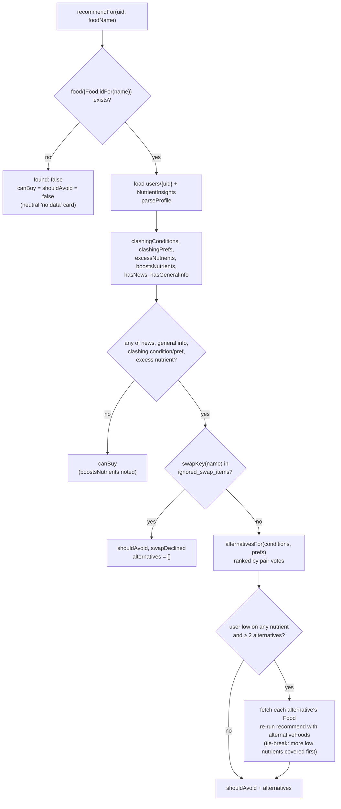

# Recommendation engine

`FoodRecommendationService` (`lib/food/food_recommendation_service.dart`)
decides, for one signed-in user and one catalogue food, whether the food is
fine to buy or should be avoided, why, and what to buy instead. The scan result
sheet and the assistant's `get_alternatives` tool both call it, so they always
agree. The catalogue it reads is described in [food-data.md](food-data.md).

## Inputs

| Source | Read by | Becomes |
| --- | --- | --- |
| `food/{Food.idFor(name)}` | `fetcher` (default `FoodRepository().get`) | `Food`; `null` → not found |
| `users/{uid}.religion`, `.dietary` (label strings) | `userFetcher` → `parseProfile` | `UserProfile.prefs` via `Preference.fromLabel` (or `fromId`) |
| `users/{uid}.health_conditions` (`HealthCondition.id`s) | same | `UserProfile.conditions` |
| `users/{uid}.ignored_swap_items` | same | `UserProfile.declinedSwaps`, re-normalised with `swapKey` |
| Diet window (receipt days + assistant food logs) | `insightsFetcher` (default `NutrientInsights.load`) | `lowNutrients`, `highNutrients` |

Unknown labels/IDs and `none` are skipped; a missing user document yields an
empty profile.

**Nutrient status.** `NutrientInsights.load(uid)` combines the
`DietWindowService` window (14 days) of receipt `nutrition` with foods logged
through the assistant, and averages each nutrient per day since tracking began
(capped at the window). Each `NutrientCoverage.status` compares that average
with `nutrientTargets` (`lib/diet/nutrient_insights.dart`):

| Status | Rule | Used as |
| --- | --- | --- |
| `lacking` | < 35% of target | `lowNutrients` |
| `low` | < 70% of target | `lowNutrients` |
| `good` | otherwise | – |
| `high` | limit nutrients (sodium) only: > 100% of limit | `highNutrients` |

If nothing has been tracked (`insights.isEmpty`), or the insights read throws
an `Exception`, nothing is low or high: nutrient checks are best-effort and
never make every nutrient look "low". (Caveat: `NutrientInsights.load` runs
its two reads with record `.wait`, which wraps failures in a
`ParallelWaitError`, an `Error`, so a real Firestore failure there is not
caught by `_loadInsights`'s `on Exception` and fails the whole call; see
limitations.)

## Decision rules

`FoodRecommendationService.recommend(food, ...)` is pure (no Firestore). It
computes:

| Field | Rule |
| --- | --- |
| `clashingConditions` | `food.healthConditions ∩ user.conditions` |
| `clashingPrefs` | `food.personalPrefs ∩ user.prefs` |
| `excessNutrients` | `food.highIn ∩ user.highNutrients` (e.g. ≥ 600 mg sodium/100 g while the diet is over 2400 mg/day) |
| `boostsNutrients` | `food.richIn ∩ user.lowNutrients`; informational only, never a reason to avoid |
| `hasNews` | `food.localNews.isNotEmpty` |
| `hasGeneralInfo` | `food.generalInfo.trim().isNotEmpty` |
| `swapDeclined` | `swapKey(food.name) ∈ user.declinedSwaps` (only evaluated when the food is not fine) |

and from them:

```dart
bool get shouldAvoid => hasNews || hasGeneralInfo ||
    clashingConditions.isNotEmpty || clashingPrefs.isNotEmpty ||
    excessNutrients.isNotEmpty;
bool get canBuy => found && !shouldAvoid;
```

- **Fine food** (`!shouldAvoid`): returns `found: true`, `boostsNutrients`, no
  alternatives, `swapDeclined: false`.
- **Avoid**: returns all reasons, `generalInfo`, and
  `alternatives = food.alternativesFor(conditions: user.conditions, prefs: user.prefs, tieBreak: ...)`,
  or `[]` when `swapDeclined`. The full user sets are passed (not only the
  clashing subsets) so unmatched sides fall back to `none`.
- **Not found** (`recommendFor` only): `FoodRecommendation(food: name, found: false)`.
  Then `shouldAvoid` and `canBuy` are both `false`: the engine has no opinion.

`swapKey(name)` is `name.trim().toLowerCase()` with whitespace runs collapsed
to one space; it is what the scan sheet writes to `ignored_swap_items`.



## Ranking alternatives

`Food.alternativesFor` (`lib/food/food.dart`):

1. **Rows**: the user's conditions that are keys of `alternatives`; if none
   are, the `none` row.
2. **Columns**: within each row, the user's preferences that are keys of that
   row; if none are, the `none` column.
3. Every selected cell (pair) is a list. Each substitute gets one **vote** per
   list it appears in.
4. Sort by votes, descending. Equal votes are ordered by `tieBreak` if given;
   the sort is stable, so otherwise they keep first-seen order.

When a user has a matching condition, the `none` row is **not** consulted, so
a substitute only gets several votes when it is listed under several of the
user's matched pairs (e.g. two conditions, or two preferences, both listing
it).

The tie-break used by `recommend` is `boosts(b) - boosts(a)`, where
`boosts(alt)` is the number of the user's `lowNutrients` that the alternative's
stored `Food` is `richIn`. `recommendFor` only fetches alternative foods when
the user has low nutrients and there are at least two alternatives; a failed
fetch counts as zero boosts.

## Worked examples

Using the `bacon` and `crisps` fixtures from
`test/food/food_recommendation_service_test.dart`:

```text
Bacon  health_conditions: [hypertension]   personal_prefs: [vegan, halal]
       general_info: "Processed meat high in salt and saturated fat."
       alternatives:
         none:         none → [Roast chicken]
                       vegan → [Smoked tofu, Tempeh bacon]
                       halal → [Halal turkey rashers]
         hypertension: none → [Grilled chicken, Smoked tofu]
                       vegan → [Smoked tofu, Lentils]
                       halal → [Grilled halal chicken]
```

| User (`users/{uid}`) | Result |
| --- | --- |
| nothing set | `shouldAvoid` (general info only) → `none/none`: `[Roast chicken]` |
| `dietary: ["Vegan"]` | clashing pref `vegan` → `none/vegan`: `[Smoked tofu, Tempeh bacon]` |
| `health_conditions: ["hypertension"]` | clashing condition → `hypertension/none`: `[Grilled chicken, Smoked tofu]` |
| hypertension + `Vegan` | both clash → `hypertension/vegan`: `[Smoked tofu, Lentils]` |
| hypertension + `Vegan` + `Halal` | two cells, one vote each → `[Smoked tofu, Lentils, Grilled halal chicken]` |
| `dietary: ["Gluten free"]`, `health_conditions: ["egg_allergy"]` | no clash, but general info → falls back to `none/none`: `[Roast chicken]` |
| any of the above + `ignored_swap_items: ["bacon"]` | same reasons, `swapDeclined: true`, `alternatives: []` |

Nutrient example: `crisps` has `NA: 700` (≥ 600 → `highIn` sodium) and
`none/none → [Popcorn, Oranges]`, no news or general info.

- User's diet is within the sodium limit → `canBuy` (crisps are only flagged
  when the user is already over).
- Diet averages > 2400 mg sodium/day → `excessNutrients: {sodium}`,
  `shouldAvoid`, alternatives `[Popcorn, Oranges]`.
- Same, and the diet is also low in vitamin C, with `Oranges` stored with
  `VITC: 53` (≥ 12 → `richIn`) → both alternatives have one vote; Oranges
  boost one low nutrient, so the result is `[Oranges, Popcorn]`.

## Where it is consumed

### Scan result sheet

`lib/scan/analysis_result_sheet.dart`. `ScanPage` passes
`FoodRecommendationService()` and the user ID when someone is signed in. For an
identified product (no error), `_newsFoodName` maps the product name onto a
catalogue name with `matchKnownFood` (see
[food-data.md](food-data.md#matching-scanned-names-known_foodsgdart--food_matcherdart))
and `_RecommendationCard` renders `recommendFor(uid:, foodName:)`:

| State | Card |
| --- | --- |
| loading | small spinner |
| `canBuy` | green (`primaryContainer`): "Safe to buy: …", plus "Good source of X, which your recent diet is low in." when `boostsNutrients` is non-empty |
| `!found` | neutral (`surfaceContainerHighest`, help icon): "No data for this product yet, so we can’t give a personal recommendation." |
| otherwise | red (`errorContainer`) "Not recommended": reason chips (`Active food news`, condition/preference labels, `High in <nutrient>`), a personalised sentence built from `generalInfo` and clashes, the over-the-limit note, the boost note, and **Try instead** with the first 3 alternatives |

The **"Don’t suggest a swap for this item again"** checkbox
(`CheckboxListTile`) is shown when a user is signed in, a food name is known,
and there is a legacy alternative, a recommendation service, or the swap is
already skipped. Toggling it writes
`users/{uid}.ignored_swap_items` with `FieldValue.arrayUnion` /
`arrayRemove` of the normalised name (`_itemKey`, same normalisation as
`swapKey`), merges into the user document, hides the card's alternatives
immediately (`hideAlternatives`), and reverts with a snackbar if the write
fails. On later scans the service reports `swapDeclined` itself.

### Assistant `get_alternatives`

`FirestoreAssistantRepository._alternatives` (`lib/assistant/assistant_repository.dart`)
builds the service with fetchers that read through the repository's own
`FirebaseFirestore`, calls `recommendFor`, and returns:

```jsonc
// not in the catalogue
{"found": false, "alternatives": []}

// found
{
  "found": true,
  "food": { /* food/{id} fields: name, alternatives, health_conditions,
               personal_prefs, local_news, general_info, nutrients */ },
  "shouldAvoid": true,
  "canBuy": false,
  "reasons": [
    "Local news: …",                 // if hasNews
    "<general_info>",                // if hasGeneralInfo
    "Health condition: High blood pressure",
    "Preference: Vegan",
    "Diet already high in Sodium"
  ],
  "excessNutrients": ["Sodium"],     // Nutrient labels
  "boostsNutrients": ["Vitamin C"],
  "swapDeclined": false,
  "source": "food/bacon",
  "updatedAt": "2026-11-07T…Z",      // ISO string or null
  "alternatives": [                  // at most 12, in ranked order
    {
      "name": "Smoked tofu",
      "knownConflicts": ["Vegan"],   // the alternative's own clashes with this
                                     // user (labels); null if not in the catalogue
      "food": { /* same shape as above */ } ,   // or null
      "source": "food/smoked_tofu",
      "updatedAt": null
    }
  ]
}
```

`knownConflicts` lets the model warn when a suggested substitute itself clashes
with the user; the engine does not filter such substitutes out.

## Testing

```sh
flutter test test/food                          # Food, matcher, recommender
flutter test test/assistant_repository_test.dart # get_alternatives contract
```

- `test/food/food_test.dart`: `alternativesFor` row/column fallback, voting,
  `tieBreak`; `richIn`/`highIn` thresholds; `fromMap`/`toMap`.
- `test/food/food_recommendation_service_test.dart`: `recommend` (fine,
  general info only, news only, condition, preference, pair, nutrients,
  declined swaps), `parseProfile`, and `recommendFor` with injected
  `fetcher` / `userFetcher` / `insightsFetcher` (including a failing insights
  read).
- `test/assistant_repository_test.dart` (`get_alternatives` group): the tool
  delegates to an injected `FoodRecommendationService` and the output shape.

Use `FoodRecommendationService.recommend` directly for new rules; build
`NutrientInsights` with `NutrientInsights.fromDaily({day: {'NA': 3000}}, today: day)`
to drive low/high nutrients.

## Known limitations and future work

- **Small catalogue.** Only foods in `food` can be judged; 11 are in
  `food.txt` / `known_foods.g.dart`. Anything else is "No data" on the scan
  sheet and `found: false` in the assistant. Matching relies on
  `matchKnownFood`, which only knows foods compiled into the app at the last
  `tool/generate_food.dart` run.
- **AI-generated data.** Clash sets, general info, alternatives and nutrient
  amounts are LLM output (`tool/fill_food.dart`), not curated or reviewed.
- **Receipts get no buy/avoid flags.** Receipt items feed the nutrient
  insights, but nothing in `lib/diet/` calls the recommender or the matcher.
- **Health readings are not used.** Only the self-declared
  `users/{uid}.health_conditions` list counts. Blood pressure, heart rate,
  body measurements and `healthData/latest` (`lib/health_data/`) are not read
  by the engine (e.g. a high reading does not imply `hypertension`).
- **Substitutes are not re-checked.** An alternative that itself clashes with
  the user's preferences or conditions is still offered (the assistant only
  annotates it with `knownConflicts`); substitutes are not ranked down for
  being `highIn` a nutrient the user is over on.
- **Coarse avoid signal.** Any non-empty `general_info` or `local_news` makes
  every user avoid the food; news is not filtered by the user's location
  beyond the "Coventry and the UK" prompt used when generating it.
- **`lib/ai/food_compliance_service.dart` is unused.** `FoodComplianceService`
  (an LLM verdict against religion/dietary preferences) is only referenced by
  `lib/ai/food_check_demo.dart`, and `FoodCheckDemo` itself is not mounted
  anywhere in the app.
- **Insights failures are not really best-effort.** `_loadInsights` catches
  `on Exception`, but `NutrientInsights.load` (and `recommendFor`'s own
  `(_userFetcher(uid), _loadInsights(uid)).wait`) surface failures as
  `ParallelWaitError`, which extends `Error`. The unit test injects a plain
  `Exception`, so it does not cover this path.
- **Errors on the scan card.** `_RecommendationCard` only checks
  `snap.hasData`, so if `recommendFor` throws (e.g. Firestore unavailable) the
  card keeps spinning instead of showing an error. Its future is also created
  in `build`, so the recommendation is re-fetched on every rebuild of the
  sheet (e.g. toggling the swap checkbox).
