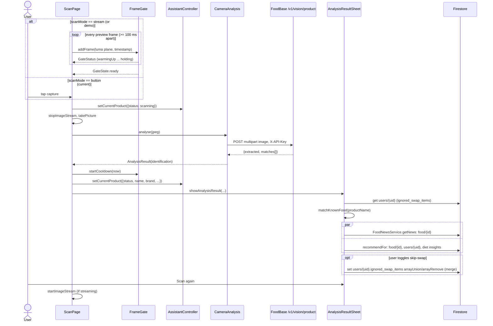

# Product scanning

The camera product scan photographs a packaged food, identifies it, and shows a
bottom sheet with the product details, any food news, and a personal buy/avoid
verdict. The result is also handed to the shopping assistant.

## Shopping companion mode

Tap **Start** in the panel over the camera to enable a foreground shopping
session. This temporarily enables the existing FrameGate auto-capture even when
the compile-time `scanMode` is `button`. New results appear in the panel and
are summarized aloud using the saved voice settings; they do not automatically
open the result sheet. **Details** opens that sheet on request.

The microphone, editable transcript, Send, Stop speech and alternative image
cards remain over the preview. Typed/general questions work before the first
scan. The full conversation is still available from the app-bar chat button.
There is no always-on listening. Automatic captures pause while briefing or
answering, listening, speaking, reviewing a draft or confirming a write.

The page owns `ShoppingCompanionController` and shares the signed-in shell's
`AssistantController`. `ProductBriefingService` uses the existing personalized
recommender and validates stored substitutes. Product identities and generation
tokens suppress repeat announcements and discard stale product replies.
Stopping, leaving, or backgrounding the session stops audio; the user explicitly
starts it again on return. Normal button scanning still opens the original
result sheet when companion mode is off.

| File | Role |
| --- | --- |
| `lib/scan/scan_page.dart` | `ScanPage`: camera lifecycle, frame streaming, capture, handoff to the assistant and result sheet |
| `lib/scan/scan_config.dart` | `ScanMode` enum and the compile-time `scanMode` constant |
| `lib/scan/frame_gate.dart` | `FrameGate`: decides when a live preview frame is worth sending (auto-capture) |
| `lib/scan/camera_analysis.dart` | `CameraAnalysis`, `AnalysisResult`, legacy `AnalysedItem` |
| `lib/scan/product_identification_service.dart` | `ProductIdentification` model, `ProductIdentificationProvider` interface, `ApiProductIdentification` (FoodBase backend) |
| `lib/foodbase/foodbase_api.dart` | `identifyFoodProduct()`: the HTTP call to FoodBase |
| `lib/scan/analysis_result_sheet.dart` | `showAnalysisResult()` / `AnalysisResultSheet`: the result bottom sheet |
| `lib/food/food_matcher.dart` | `matchKnownFood()`: maps a catalogue product name to a stored generic food |
| `lib/food_news/food_news_service.dart` | `FoodNewsService.getNews()` for the alert card |
| `lib/food/food_recommendation_service.dart` | `FoodRecommendationService.recommendFor()` for the verdict card (see `docs/recommendations.md`) |

`ScanPage` is opened from `lib/pages/home_page.dart` as
`ScanPage(userId: widget.user.uid, assistant: _assistant)`. It only runs on
Android and iOS (`ScanPage.isSupported`); elsewhere it shows "Scanning is only
supported on Android and iOS."

## Which backend identifies the product

Identification does **not** use OpenRouter. `CameraAnalysis` defaults to
`const ApiProductIdentification()`, which calls `identifyFoodProduct()` in
`lib/foodbase/foodbase_api.dart`:

- `POST https://foodbase.dev/v1/vision/product`
- multipart form, one file field `image` (filename `product-scan.jpg`)
- header `X-API-Key: <foodBaseApiKey>` (from `lib/secrets.dart`)
- 60 s timeout, no retries; non-2xx throws `FoodBaseException`

If `foodBaseApiKey` is blank, `ApiProductIdentification.identify` returns
without a network call: a `ProductIdentification` with `status: 'unavailable'`
and the uncertainty "FoodBase API key is not configured."

`lib/openrouter/openrouter_service.dart` (`OpenRouterService`, default model
`@preset/glm-flash`, endpoint `https://openrouter.ai/api/v1/chat/completions`)
is used elsewhere: by `AssistantController` (the shopping assistant the scan
hands off to) and by `lib/ai/food_compliance_service.dart`. It is not on the
scan identification path.

## Capture modes and frame gating

`lib/scan/scan_config.dart`:

```dart
enum ScanMode { stream, button }
const scanMode = ScanMode.button;
```

| Mode | Behaviour |
| --- | --- |
| `ScanMode.button` (**current setting**) | Live preview only; a photo is sent when the capture button is pressed. The `FrameGate` is not fed and its indicator chip is hidden. |
| `ScanMode.stream` | Preview frames go through `FrameGate`; a photo is taken automatically when it returns `GateState.ready`. The capture button still works. |

`ScanPage(demo: true)` forces streaming regardless of `scanMode`, replaces each
capture with a 250 ms red flash (no API call), and shows the gate metrics on
screen. Nothing in `lib/` currently constructs a demo `ScanPage`.

### Streaming

- Camera: back lens, `ResolutionPreset.high`, no audio; image format
  `yuv420` on Android, `bgra8888` on iOS.
- `_onFrame` drops frames while a capture is being analysed, and throttles
  to one frame per `_frameInterval = 100 ms`.
- Brightness plane passed to the gate: the Y plane on Android
  (`pixelStride = plane.bytesPerPixel ?? 1`, offset 0); on iOS the BGRA plane
  with `pixelStride: 4, channelOffset: 1` (green as a luma stand-in).
- The stream is stopped before `takePicture()` (Android cannot take a picture
  while streaming) and restarted after the result sheet closes.
- The camera is released on `AppLifecycleState.inactive` (only once
  initialised, so the permission dialog does not break initialisation) and
  restarted on `resumed`.

### `FrameGate` algorithm

Each frame is shrunk to a 24×24 grid (`_grid = 24`), each cell the mean of
3×3 samples (`_samplesPerCell = 3`). The grid's mean brightness is subtracted
so auto-exposure changes do not register as motion. From the grid it computes:

| Metric | Definition |
| --- | --- |
| `brightness` | mean luma of the frame (before mean subtraction) |
| `contrast` | mean absolute deviation from the mean |
| `motion` | mean abs difference from the previous grid, exponentially smoothed with `_motionSmoothing = 0.5` |
| `detail` | mean abs horizontal + vertical gradient over the centre half of the grid (cells 6..17) |
| `novelty` | mean abs difference from the last *sent* grid (255 if nothing sent yet) |

Default thresholds (`FrameGate()` constructor; `ScanPage` uses the defaults):

| Parameter | Default | Meaning |
| --- | --- | --- |
| `holdDuration` | 1 s | steady time needed before sending |
| `cooldown` | 5 s | no sends for this long after a send / `startCooldown` |
| `motionThreshold` | 6 | smoothed `motion` must be ≤ this to count as steady |
| `detailThreshold` | 4 | `detail` must reach this to count as an item |
| `noveltyThreshold` | 12 | `novelty` must reach this for a scene to count as new |
| `minBrightness` | 25 | below this the frame is too dark to identify (`noItem`) |
| `pocketBrightness` | 20 | below this the lens is covered (`inPocket`) |
| `dimBrightness` | 50 | with `pocketContrast`, a dim featureless frame counts as covered |
| `pocketContrast` | 2 | contrast below this while dimmer than `dimBrightness` → `inPocket` |

`addFrame` evaluates in this order and returns the first match:

1. No previous frame → `warmingUp`.
2. `brightness < 20` or (`brightness < 50` and `contrast < 2`) → `inPocket`.
3. If steady and `novelty ≥ 12`, set `_sceneChangedSinceSend = true` (this
   happens even during cooldown, so the same item can be re-sent after it was
   taken away).
4. Less than `cooldown` since `_lastSentAt` → `coolingDown` (progress = fraction of cooldown elapsed).
5. `motion > 6` → `moving`.
6. `brightness < 25` or `detail < 4` → `noItem`.
7. `_sceneChangedSinceSend == false` → `alreadySent`.
8. Held for less than `holdDuration` → `holding` (progress = fraction of hold).
9. Otherwise → `ready`: records the grid as `_lastSent`, sets `_lastSentAt`,
   clears `_sceneChangedSinceSend`.

Steps 2 and 4–7 also reset the hold timer. After every capture (success or
failure) `ScanPage` calls `_gate.startCooldown(_clock.elapsed)`, so the 5 s
cooldown runs from when the answer arrived, not from when the frame passed.

The on-screen chip (`_GateIndicator`) maps states to text: `warmingUp`
"Starting…", `inPocket` "Camera covered", `coolingDown` "Ready again
shortly…", `moving` "Hold the camera steady", `noItem` "Show an item to the
camera", `alreadySent` "Show another item", `holding`/`ready` "Hold still…",
and "Identifying…" while busy. Raw metrics are shown in debug builds or demo
mode.

## Identification request and response

`CameraAnalysis.analyse(jpegBytes)` calls `_service.identify(jpegBytes)` and
wraps the answer as `AnalysisResult(identification: ...)`. Any exception in
`_capture` (camera or network) becomes
`AnalysisResult(error: 'Could not identify this photo. Check your connection and try again.')`.

### Mapping the FoodBase response

`ApiProductIdentification._fromFoodBaseResponse` reads:

- `extracted` (map) and `matches` (list). The first match with a `product`
  map is the best match.
- `productName` ← `product.name_default` / `product.name`, else `extracted.name`
- `brand` ← `product.brand`, else `extracted.brand`
- `variant` ← `product.variant` / `flavor` / `flavour`
- `packageSize` ← `product.quantity` / `package_size`, else `extracted.quantity`
- `sku` ← `product.sku`
- `gtin` ← `product.gtin` / `barcode` / `ean` / `upc`, kept only if it passes
  a GTIN-8/12/13/14 check-digit test (`_isValidGtin`)
- `catalogProductId` ← `product.id`
- `confidence` ← `bestMatch.score`, else `extracted.confidence`, clamped to
  0..1 and converted to a percentage

Status:

| Condition | `status` |
| --- | --- |
| no product name found | `unreadable` |
| name found and a catalogue match exists | `identified` |
| name found from `extracted` only | `ambiguous` |
| `foodBaseApiKey` blank | `unavailable` |

Per-field confidences: name = overall; brand/variant = overall if present,
else 0; SKU/GTIN = 100 if present, else 0. `evidence` and `uncertainties` are
generated strings (for example "No verified GTIN was returned by the product
catalog.").

### `ProductIdentification` fields

| Field | Type | Notes |
| --- | --- | --- |
| `status` | `String` | `identified`, `ambiguous`, `unreadable`, `not_a_product`, `unavailable` |
| `productName`, `brand`, `variant`, `packageSize` | `String?` | |
| `sku`, `gtin` | `String?` | SKU is seller-specific, GTIN is the barcode number |
| `catalogProductId` | `String?` | FoodBase product id |
| `confidence` | `int` | 0–100 overall |
| `productNameConfidence`, `brandConfidence`, `variantConfidence`, `skuConfidence`, `gtinConfidence` | `int` | 0–100 |
| `evidence`, `uncertainties` | `List<String>` | |

`displayName` joins brand (unless all brand tokens already appear in the
name), product name, variant, and package size (each skipped if the name
already contains it).

`ProductIdentification.fromJson` accepts a JSON-schema-style model reply
(`status` must be one of `identified`/`ambiguous`/`unreadable`/`not_a_product`;
`identified` requires `product_name`; confidences may be numbers, `"85%"`
strings, 0..1 fractions or a nested `confidence` map). Nothing in `lib/` or
`test/` calls it: it is left over from an earlier model-based backend.
`not_a_product` is therefore never produced by the current FoodBase path.

## Result sheet

`showAnalysisResult(context, result, newsService:, recommendationService:, userId:)`
opens `AnalysisResultSheet` in a scroll-controlled modal bottom sheet.
`ScanPage` always passes `FoodNewsService()`, and passes
`FoodRecommendationService()` whenever `userId` is non-null (always, from
the home page).

Top to bottom:

1. **Title** "Product scan".
2. **Main card**, first match wins:
   - `result.error` → `_ScanError(error)`
   - `result.identification` → `_ProductCard`
   - `result.item` → legacy `_ItemCard` (score badge + highlights)
   - otherwise "No product details were returned. Please try again."
3. **Legacy "Try instead" card**: only if there is no identification,
   `result.alternative` is set, and the skip-swap box is unchecked.
4. **Skip-swap checkbox** "Don't suggest a swap for this item again": shown
   when `userId` and a food name are present and there is an alternative, a
   recommendation service, or the box is already checked.
5. **Food news alert** (`_FoodNewsAlert`): when a news service is given,
   there is an identification and no error.
6. **Recommendation card** (`_RecommendationCard`): when a recommendation
   service and `userId` are given, there is an identification and no error.
7. **"Scan again"** button, which pops the sheet.

### Product card

`_ProductCard` shows `displayName` (or "Product not identified"), a status
line, and the fields Brand, Product, Variant, Pack size, SKU (if printed),
Barcode / GTIN, and Catalog ID (only when present). Missing values read "Not
found in photo"; a per-field `NN%` is shown when its confidence is > 0. Status
lines:

| `status` | Text |
| --- | --- |
| `identified` | "Model estimate: N%", or "Identified · model did not provide a confidence estimate" when confidence is 0 |
| `ambiguous` | "Possible match · model estimate N%" |
| `unreadable` | "Packaging is difficult to read" |
| `unavailable` | "API identification is unavailable" |
| anything else | "No packaged product detected" |

`evidence` is listed under "Visible evidence" and `uncertainties` under
"Needs a clearer photo".

### Food name used for lookups

The news and recommendation cards, and the skip-swap key, all use
`_newsFoodName(product)`: the product name (or `displayName` if the name is
empty), mapped through `matchKnownFood()` (tried on the name first, then on
`displayName`) to the generic stored food name. If no known food matches, the
raw name is used.

`matchKnownFood` (`lib/food/food_matcher.dart`) tokenises both names
(lower-case, split on non-alphanumerics, stop words `and the of with in a`
removed, crude singularisation: `-ies` → `-y`, trailing `s` dropped unless
`ss`), ignores bracketed text in the stored name, and allows run-together
words ("redbull" for "Red Bull") and prefixes of at least 3 letters
("veg" for "vegetable"). A candidate must contain the stored name's last word
(its head noun) and at least half of its words. The candidate with the most
matching words wins; ties go to the higher share. Candidates come from the
generated `KnownFood` enum in `lib/food/known_foods.g.dart`.

### Food news alert

`FoodNewsService.getNews(name)` reads `food/{Food.idFor(name)}` via
`FoodRepository.get`. `hasAlerts` is true when `localNews` or `generalInfo` is
non-empty.

- No alerts: green (`primaryContainer`) card with
  `FoodNewsService.noNewsMessage` = "No negative news discovered".
- Alerts: red (`errorContainer`) "Food alert" card listing
  "Local news: …" before "General info: …", omitting either one that is empty.

### Recommendation card

`FoodRecommendationService.recommendFor(uid:, foodName:)` returns a
`FoodRecommendation`. The card shows one of three variants:

| Condition | Card |
| --- | --- |
| `r.canBuy` (`found && !shouldAvoid`) | Green "Safe to buy: …", plus "Good source of X, which your recent diet is low in." if `boostsNutrients` is non-empty |
| `!r.found` (food not in the `food` collection) | Neutral (`surfaceContainerHighest`) card: "No data for this product yet, so we can't give a personal recommendation." |
| otherwise | Red "Not recommended" card: reason chips (active news, clashing conditions, clashing preferences, "High in X"), a personalised rationale, an excess-nutrient note, a boost note, and up to 3 "Try instead" alternatives unless `hideAlternatives` |

`hideAlternatives` is the sheet's `_skipSwap`. How the verdict is computed is
documented in `docs/recommendations.md`.

### Skip-swap override (`ignored_swap_items`)

- On open, `_loadOverride()` reads `users/{uid}` and checks the
  `ignored_swap_items` array for the item key.
- Toggling the checkbox writes
  `users/{uid}.ignored_swap_items` with `FieldValue.arrayUnion([key])` or
  `FieldValue.arrayRemove([key])`, using `set(..., SetOptions(merge: true))`.
  On `FirebaseException` the box reverts and a snackbar shows the error.
- The key is `name.trim().toLowerCase()` with whitespace collapsed, the same
  rule as `FoodRecommendationService.swapKey`, which reads the array back into
  `UserProfile.declinedSwaps`.

## Handoff to the shopping assistant

`ScanPage._capture` calls `AssistantController.setCurrentProduct` twice:

1. Before the photo: `{'status': 'scanning', 'scannedAt': <UTC ISO-8601>}`.
2. After analysis, before the sheet opens:

```text
status            product.status, or 'unavailable' if there is no identification
scannedAt         UTC ISO-8601
name              product.displayName      ┐
productName, brand, variant, packageSize,  │ only when an identification
gtin, catalogProductId, confidence,        │ exists
evidence, uncertainties                    ┘
error             result.error, when set
```

The assistant model reads this through its `get_current_product` tool, which
returns `{'available': false}` or `{'available': true, ...product}`
(`lib/assistant/assistant_controller.dart`). The chat-bubble action on the
scan app bar (`_openAssistant`) stops the stream, calls
`assistant.initialize()`, pushes `AssistantPage`, then `assistant.suspend()`
and restarts the stream on return.

## Sequence



## Dead and legacy code

- `AnalysisResult.item` and `AnalysisResult.alternative` (type `AnalysedItem`)
  are never set by any code in `lib/`: `CameraAnalysis.analyse` only sets
  `identification`, and `_capture` only sets `error`. The `_ItemCard` /
  `_ScoreBadge` branch and the legacy "Try instead" block in the sheet are
  reachable only from `test/widget_test.dart`
  ("AnalysisResultSheet shows the item and its alternative").
- `ProductIdentification.fromJson` and the `not_a_product` status are unused
  (see above).
- `FrameGate` is unused at runtime while `scanMode == ScanMode.button`, and no
  caller creates `ScanPage(demo: true)`.

## Known issues

- **The skip-swap write is rejected by `firestore.rules`.** The `users/{uid}`
  create and update rules only allow the keys `religion`, `dietary`,
  `health_conditions` and `updatedAt`, so writing `ignored_swap_items`
  fails with permission-denied once those rules are deployed. The checkbox
  then reverts and shows the "Could not save swap preference" snackbar.
- `_FoodNewsAlert` and `_RecommendationCard` call `getNews` /
  `recommendFor` inside `FutureBuilder.future` in `build`, so every rebuild
  of the sheet re-runs the lookups. Toggling the checkbox and the
  `setState` in `_loadOverride` both cause a rebuild.
- With `status: 'unavailable'` (no FoodBase key) the identification is still
  non-null, so the news and recommendation cards run with an empty food name.

## Testing

| Test | Covers |
| --- | --- |
| `test/scan/frame_gate_test.dart` | steady item sent once after a second; blank scene never sent; moving camera never sent; brightness change alone is not motion; new item sent after the previous one; same item re-sent after being taken away; dark lens and dim featureless lens count as in a pocket; nothing sent during cooldown; `startCooldown` restarts the cooldown |
| `test/food/food_matcher_test.dart` | catalogue names to known foods, run-together/separated names, no match |
| `test/food_news_service_test.dart` | `FoodNewsService` |
| `test/widget_test.dart` | `ScanPage` unsupported-platform message; legacy `AnalysisResultSheet` item + alternative rendering |

There are no tests for `ApiProductIdentification._fromFoodBaseResponse`,
`ProductIdentification.displayName`, or the identification/news/recommendation
branches of the sheet.

```sh
flutter test test/scan test/food/food_matcher_test.dart test/food_news_service_test.dart test/widget_test.dart
```
